# SUPERB Pareto Execution Plan — 2026-10-11 05:58

> **Method:** READ (every TODO from `TODO_LIST.md`, the living source — rebuilt and
> fully harvested by the 2026-10-11 05:52 docs-health audit) → UNDERSTAND (each row
> carries source-report citations and verified evidence) → RESEARCH (this session's
> gate/CI/release-page findings) → REFLECT (Pareto tiers below) → plan.
>
> **Scope:** all 15 open TODO rows + 7 Blocked decisions + 6 cross-repo rows.
> The 6 `WONT` rows and the 2 trigger-gated rows (minCorpusVectors, directive-claims
> re-verify) carry no scheduled work by design — they are listed as dormant.
> Sources: [TODO_LIST.md](../../TODO_LIST.md), [ROADMAP.md](../../ROADMAP.md),
> status reports archived 2026-10-11 (`docs/status/archived/`, manifest in the
> archive README).

---

## Step 1 — Pareto breakdown

### 🎯 The 1% that delivers 51% of the result

**Cut ssetest v0.5.0 + backfill the two missing GitHub Release pages.**

One release execution and two `gh release create` calls. Why this is the 1%:
it is the only item where *consumers* are actively blocked — the breaking
`WithLastEventID(sse.EventID)` change sits untagged on master (datastartest
compiles only because it never calls the changed option), and the project's
public release page still advertises sseparse v0.2.0 as "Latest" while v0.6.2
and sseparse v0.2.1 exist only as tags. Everything else in the backlog is
hardening; this is the published surface itself. Pure execution, ~3 hours,
zero design risk (code + CHANGELOG already verified ready).

### 🎯 The 4% that delivers 64% of the result

**+ Ubuntu-26 runner action (deadline 2026-10-19) + the verify.sh hardening trio.**

Four more tasks. Ubuntu-26 is a time-bomb with a date on it: GitHub flips
`ubuntu-latest` to Ubuntu 26 starting 2026-10-19 and 10 of 11 CI jobs ride that
label — this repo has repeatedly broken on environment drift (vendorHash, lint
pin, format gate). The verify.sh trio (AGENTS-facts assertion, bare-shfmt grep
guard, coverage root-scope fix) mechanizes the two drift classes that reddened
master four times in five weeks: documented facts going stale silently, and the
formatter flip-flop. After these, the drift classes have detectors instead of
relying on session vigilance.

### 🎯 The 20% that delivers 80% of the result

**+ Coverage ratchet + the docs-notes cluster + post-mortem + buildflow WONT records.**

The ratchet replaces zero-margin float thresholds (99/100/99) against a
floating toolchain — the mechanism that nearly flipped the gate red twice
(measured: identical code, 99.2% CI vs 98.8% local). The docs notes
(sseparse raw-ID contract, zero-`EventID` semantics, reason comments) ship
consumer-facing truth that currently lives only in AGENTS.md. The post-mortem
converts six days of red-CI history into one durable lesson. The two WONT
records stop weekly tool-noise regurgitation.

### 🎯 The remaining 80% (to 100%)

AGENTS deep prune (scoped dedicated session), CI wall-clock anomaly,
release-verify release-page check, the buildflow environment remainder
(re-run, devShell tools, go-mod-update), all six cross-repo batches, the
seven blocked decisions (user-owned), and the two dormant trigger-gated rows.
None of these block consumers; all are listed in the full tables below so
nothing is lost.

---

## Step 2 — Comprehensive plan (30–100 min tasks, ALL TODOs)

Sorted by tier → impact → customer-value → effort. "Src" = TODO_LIST row.

| #  | Tier | Task                                                                                                | Src        | Min  | Impact | Effort | Customer value |
| -- | ---- | --------------------------------------------------------------------------------------------------- | ---------- | ---- | ------ | ------ | -------------- |
| T1 | 1%   | **Cut ssetest v0.5.0**: docs pass, CHANGELOG cut, release-verify, tag, proxy probe, release page     | O1, O9     | 90   | high   | M      | **high** — unblocks typed API for every consumer |
| T2 | 1%   | **Backfill GitHub Release pages** for v0.6.2 + sseparse/v0.2.1 from CHANGELOG notes                  | O2a        | 30   | med    | S      | med-high — public release surface stops lying |
| T3 | 4%   | **Ubuntu-26 action**: pin `ubuntu-24.04` in ci.yml (recommended default) or schedule the 10-19 watch | O3         | 30   | high   | S      | med — protects every future CI signal |
| T4 | 4%   | **verify.sh: AGENTS-facts assertion** (documented thresholds ≡ flake.nix; directives ≡ three go.mod) | O6         | 60   | high   | M      | med — kills the stale-docs class at the gate |
| T5 | 4%   | **verify.sh: bare-shfmt grep guard** over `scripts/*.sh`                                             | O10        | 30   | med    | S      | med — second net for the twice-shipped flip-flop |
| T6 | 4%   | **flake.nix: coverage root-scope → package `.`** + gate re-run                                       | O7         | 30   | med    | S      | med — report authors stop measuring 59% |
| T7 | 20%  | **Coverage ratchet**: baseline file + up-only gate logic in the coverage-gate app                    | O5         | 100  | high   | M      | med — drift-proof gates forever |
| T8 | 20%  | **Coverage ratchet: mutation-verify** (simulated regression reddens; improvement moves baseline) + docs | O5        | 45   | med    | S      | med |
| T9 | 20%  | **sseparse/README: raw-ID contract note + ingestion cross-link** (incl. failure-message pointer)     | O8         | 30   | med    | S      | med — parser consumers see the design truth |
| T10 | 20% | **sseparse reason comments**: re-export/API-break rationale on the three suppressed fields           | O11        | 30   | low    | S      | low — future tool runs pre-answered in code |
| T11 | 20% | **Red-streak post-mortem** (2026-10-04 → 10-10): one paragraph, root causes as a class               | O13        | 30   | med    | S      | low-med — history becomes a lesson |
| T12 | 20% | **Buildflow WONT records**: sseparse json-v1 + `lo.Filter` as `.buildflow.yml` policy notes          | O4b        | 45   | low    | S      | low — weekly tool noise stops |
| T13 | 80% | **Buildflow re-run** on the green tree; record remaining findings                                    | O4a        | 60   | low    | M      | low |
| T14 | 80% | **Buildflow env remainder**: oxlint exclusion, lychee+vulnix into devShell, go-mod-update re-run     | O4c/d/e    | 100  | low    | M      | low |
| T15 | 80% | **CI run 36883370012 wall-clock anomaly** investigation                                              | O12        | 60   | low    | M      | low — rules out a queue-eating-runs hazard |
| T16 | 80% | **AGENTS deep prune pass 1**: inventory every bullet (KB, keep/compress/delete)                      | O16        | 100  | med    | M      | med — session startup cost drops for every future agent |
| T17 | 80% | **AGENTS deep prune pass 2**: rewrite + per-paragraph verify-before-delete + ≤30 KB gate             | O16        | 100  | med    | M      | med |
| T18 | 80% | **release-verify.sh: release-page check** + CONTRIBUTING checklist line                              | O2b        | 45   | low    | S      | low — the gap class gets a detector |
| T19 | 80% | **go-datastar hygiene batch** (in their repo, their gates)                                           | C1         | 100  | med    | L      | med — downstream consumer chain health |
| T20 | 80% | **pdd → go-sse v0.6.2 pin bump** (fresh clone; vendor-hash dance)                                    | C2         | 60   | low    | M      | low — consumer pin chain uniform |
| T21 | 80% | **Sibling nolint migration** (wise-go ×2, go-business-rules ×2 → native directive form)              | C3         | 45   | low    | S      | low — kills golangci warnings fleet-side |
| T22 | 80% | **crush-config: session-start CI probe hook** (mechanize the four-session IMP)                       | C4         | 90   | med    | M      | med — red-master caught at minute zero |
| T23 | 80% | **branching-flow upstream README note** (native form is the golangci-invisible one)                  | C5         | 30   | low    | S      | low |
| T24 | 80% | **BuildFlow/go-branded-id upstream issues** (verify-before-filing first): shfmt args, BD001 idempotence, const resolution | C6 | 60 | low | M | low |
| T25 | 80% | **Fleet Name-literal sweep**: grep sibling repos for non-literal brand `Name()` returns              | C6         | 30   | low    | S      | low — prevents the BD001 stub-loop elsewhere |
| T26 | —    | **Blocked-decision execution window**: briefs for B1/B2/B5/B6 (options + recommendation), then execute on answer | B1/B2/B5/B6 | 60+ | high | M | high once unblocked |
| T27 | —    | **Dormant rows**: minCorpusVectors (next WPT ingestion) + directive-claims re-verify (next root tag) — no action; listed so nothing is lost | O14/O15 | — | — | — | — |

Blocked/user-host-only, no task until decided: B3 (dependabot policy),
B6 (browser-E2E scope), B7 (buildcache rotation), B4 (buildflow normalize —
their repo). WONT rows: no work by decision.

**Totals: 27 tasks ≈ 30 h; Tier 1+2+3 = T1–T12 ≈ 9 h → the 80%.**

---

## Step 3 — Fine breakdown (≤12 min each, ALL TODOs)

Sorted by tier → impact. Every row maps up to a T-task.

| #    | Tier | Subtask (≤12 min)                                                                 | → Task |
| ---- | ---- | ---------------------------------------------------------------------------------- | ------ |
| 1.1  | 1%   | `ssetest/README.md` options section: draft the zero-`EventID` = no-header note      | T1     |
| 1.2  | 1%   | Apply the note + example beside `WithLastEventID(sse.NewEventID("42"))`             | T1     |
| 1.3  | 1%   | `ssetest/doc.go`: confirm the zero-ID semantics paragraph is current                | T1     |
| 1.4  | 1%   | `ssetest` race suite green: `(cd ssetest && GOWORK=off go test ./... -race -count=1)` | T1   |
| 1.5  | 1%   | CHANGELOG: cut `[Unreleased]` ssetest entry into a `[ssetest 0.5.0]` section        | T1     |
| 1.6  | 1%   | Commit docs pass surgically (daemon-sweep hygiene)                                  | T1     |
| 1.7  | 1%   | `scripts/release-verify.sh ssetest/v0.5.0` pre-tag dry read; fix anything it flags  | T1     |
| 1.8  | 1%   | Tag `ssetest/v0.5.0` (annotated; `-s` if key configured, else `-a`)                 | T1     |
| 1.9  | 1%   | Push tag; `go list -m -json .../ssetest@v0.5.0` + `.mod` inspection on the proxy    | T1     |
| 1.10 | 1%   | `gh release create ssetest/v0.5.0` with CHANGELOG-derived notes                     | T1     |
| 1.11 | 1%   | datastartest compat: grep their repo for `WithLastEventID` usage; check the weekly compat workflow run | T1 |
| 1.12 | 1%   | Close the TODO row; note the tag hash in the next status report                     | T1     |
| 2.1  | 1%   | `gh release create v0.6.2` — notes from CHANGELOG `[0.6.2]`                          | T2     |
| 2.2  | 1%   | `gh release create sseparse/v0.2.1` — notes from its CHANGELOG section              | T2     |
| 2.3  | 1%   | `gh release list` — confirm both pages live; close the TODO row                     | T2     |
| 3.1  | 4%   | ci.yml: `runs-on: ubuntu-24.04` on the 10 runner jobs (one sed-scale edit, pending user go) | T3 |
| 3.2  | 4%   | `actionlint` + commit; note the flip-back condition in the workflow comment         | T3     |
| 3.3  | 4%   | If "ride" chosen instead: write the 10-19/10-20 verification checklist into the TODO row | T3 |
| 4.1  | 4%   | verify.sh: extract flake thresholds + three go directives into shell vars           | T4     |
| 4.2  | 4%   | verify.sh: grep AGENTS.md's claimed values; compare; fail with exact fix text       | T4     |
| 4.3  | 4%   | Mutation-test: hand-drift an AGENTS claim → gate red → restore                      | T4     |
| 4.4  | 4%   | verify.sh: add the bare-shfmt fingerprint grep (`((!` without space) over scripts    | T5     |
| 4.5  | 4%   | Mutation-test the guard (temporarily re-introduce the drift → red → restore)        | T5     |
| 4.6  | 4%   | flake.nix: coverage root measure call → package `.`                                 | T6     |
| 4.7  | 4%   | `nix run .#coverage` — confirm root prints ~100%, not ~59%; full gate               | T6     |
| 4.8  | 4%   | CHANGELOG `[Unreleased]`: gate-hardening entries (facts assertion, shfmt guard, scope fix) | T4–T6 |
| 5.1  | 20%  | Write the ratchet design: `docs/benchmarks/coverage-baseline.txt` format, up-only rule, escape hatch | T7 |
| 5.2  | 20%  | Check in the baseline (100.0/100.0/100.0, toolchain-attribution date stamp)         | T7     |
| 5.3  | 20%  | coverage-gate app: replace threshold compares with baseline compares (allow ≥)      | T7     |
| 5.4  | 20%  | Mutation-test: fake 99.8 → red with a "raise the baseline deliberately" message     | T8     |
| 5.5  | 20%  | Mutation-test: fake 100.1 → gate updates baseline guidance                          | T8     |
| 5.6  | 20%  | CHANGELOG + AGENTS threshold gotcha updated to the ratchet reality                  | T8     |
| 6.1  | 20%  | sseparse/README: one-line raw-string-ID contract note (transport boundary = `sse.ParseEventID`) | T9 |
| 6.2  | 20%  | `TestCorpusJSONIsCanonical` failure message: point at the README ingestion section  | T9     |
| 6.3  | 20%  | sseparse `event.go` + `corpus.go`: extend the two reason comments (re-export/API-break) | T10 |
| 6.4  | 20%  | sseparse `reader.go`: extend the `lastID` reason comment                            | T10    |
| 6.5  | 20%  | sseparse lint + tests + `branching-flow strong-id` fresh run (0 rows expected)      | T9/T10 |
| 7.1  | 20%  | Pull the 10-04→10-10 failing run list + the two failing job logs (Examples, Nix)    | T11    |
| 7.2  | 20%  | Write the post-mortem paragraph (root causes as a class); land in docs/status note  | T11    |
| 8.1  | 20%  | `.buildflow.yml`: sseparse json-v1 boundary WONT policy note (rationale inline)     | T12    |
| 8.2  | 20%  | `.buildflow.yml`: `lo.Filter` WONT policy note (samber/lo not a dep)                | T12    |
| 8.3  | 20%  | `buildflow --dry-run` — confirm the notes are visible and nothing else changed      | T12    |
| 9.1  | 80%  | Buildflow re-run `--fix --build-mode=full` on the green tree; capture the log       | T13    |
| 9.2  | 80%  | Triage remaining findings; record what is noise vs real                             | T13    |
| 9.3  | 80%  | oxlint: exclude `example/*/static/` vendored bundles                                | T14    |
| 9.4  | 80%  | devShell: add `lychee` + `vulnix` (kill the nix-run fallback)                       | T14    |
| 9.5  | 80%  | `go-mod-update` re-run; go.sum/vendorHash triage if it moves anything               | T14    |
| 9.6  | 80%  | Run `36883370012`: pull per-job timing from the API; find the 28m gap               | T15    |
| 9.7  | 80%  | Write the anomaly conclusion (queue vs retry); close or scope further               | T15    |
| 10.1 | 80%  | AGENTS prune: bullet inventory table (KB each; keep/compress/delete verdict)        | T16    |
| 10.2 | 80%  | Prune batch 1: Commands + GOEXPERIMENT + direnv sections                            | T17    |
| 10.3 | 80%  | Prune batch 2: Concurrency + Lifecycle sections                                     | T17    |
| 10.4 | 80%  | Prune batch 3: Gotchas 1–10                                                         | T17    |
| 10.5 | 80%  | Prune batch 4: Gotchas 11–25                                                        | T17    |
| 10.6 | 80%  | Prune batch 5: Conventions + Examples + tail                                        | T17    |
| 10.7 | 80%  | Per-paragraph verify-before-delete; `wc -c` ≤ 30 KB; full gate                      | T17    |
| 10.8 | 80%  | release-verify.sh: add the GitHub-release-page probe step                           | T18    |
| 10.9 | 80%  | CONTRIBUTING release checklist: add the release-page line                           | T18    |
| 11.1 | 80%  | go-datastar: fetch their master; inventory the ~14 batch items against their tree   | T19    |
| 11.2 | 80%  | go-datastar: fix nix.yml + flake.nix lying comments                                 | T19    |
| 11.3 | 80%  | go-datastar: remove `GOEXPERIMENT: jsonv2` from their ci.yml + AGENTS               | T19    |
| 11.4 | 80%  | go-datastar: CONTRIBUTING pre-push habit + session-start probe note                 | T19    |
| 11.5 | 80%  | go-datastar: golangci pin cross-check (port `scripts/golangci-pin.sh` pattern)      | T19    |
| 11.6 | 80%  | go-datastar: CHANGELOG error-family entry + dependabot PR sweep                     | T19    |
| 11.7 | 80%  | go-datastar: datastartest/broadcast coverage gates + directive-equality check       | T19    |
| 11.8 | 80%  | go-datastar: split lint job per module + JS-version CHANGELOG test extension        | T19    |
| 11.9 | 80%  | go-datastar: private-vulnerability-reporting check; push; watch their CI            | T19    |
| 12.1 | 80%  | pdd: fresh clone (not under ~/projects); `go get go-sse@v0.6.2`                     | T20    |
| 12.2 | 80%  | pdd: vendor-hash dance, race tests, push, CI watch                                  | T20    |
| 12.3 | 80%  | wise-go: migrate `webhooks.go` ×2 nolint → native `//branching-flow:ignore`         | T21    |
| 12.4 | 80%  | go-business-rules: same ×2; lint both repos clean                                   | T21    |
| 12.5 | 80%  | crush-config: design the session-start probe hook (rc snippet printing `gh run list`) | T22 |
| 12.6 | 80%  | crush-config: implement + verify warn-only behavior; commit there; fan-out intact   | T22    |
| 12.7 | 80%  | branching-flow: draft the README section (native form vs nolint form tradeoff)      | T23    |
| 12.8 | 80%  | verify-before-filing gate; file the go-branded-id const-resolution issue            | T24    |
| 12.9 | 80%  | File BuildFlow issues: shfmt project-config + BD001 idempotence guard               | T24    |
| 12.10 | 80% | Fleet grep: `func (\w+) Name\(\) string { return` non-literal in sibling repos; record | T25 |
| 13.1 | —    | Write one-page briefs: B1 (go-datastar v0.6.2), B2 (Actions-PR policy), B5 (branching-flow gate), B6 (browser E2E) — options + recommendation each | T26 |
| 13.2 | —    | On user answers: execute B-decisions (each ≤ 100 min; B2 likely a workflow change)  | T26    |
| 13.3 | —    | Dormant: `minCorpusVectors` bump ONLY when a WPT vector actually lands              | O14    |
| 13.4 | —    | Dormant: re-verify AGENTS directive claims ONLY at the next root tag                | O15    |
| 13.5 | —    | User/host-only: B3 dependabot policy, B7 buildcache rotation, B4 buildflow normalize — surface when the owner is ready | B3/B4/B7 |

**Totals: 55 subtasks; Tier 1–3 (1.1–8.3) = 33 subtasks ≈ the 80%.**

---

## Step 4 — Execution graph

```mermaid
flowchart TD
    subgraph T1PCT["🎯 1% → 51%: published surface"]
        A1["1.1–1.6 v0.5.0 docs + CHANGELOG cut"] --> A2["1.7–1.9 release-verify + tag + proxy"]
        A2 --> A3["1.10 release page v0.5.0"]
        A2 --> A4["1.11 datastartest compat check"]
        B1["2.1–2.2 backfill release pages v0.6.2 + sseparse v0.2.1"] --> B2["2.3 confirm + close row"]
    end

    subgraph T4PCT["🎯 4% → 64%: CI protection"]
        C1["3.1–3.3 Ubuntu-26 action (deadline 2026-10-19)"]
        D1["4.1–4.3 verify.sh AGENTS-facts assertion"]
        D2["4.4–4.5 bare-shfmt guard"]
        D3["4.6–4.7 coverage root-scope fix"]
    end

    subgraph T20PCT["🎯 20% → 80%: drift-proofing + truth"]
        E1["5.1–5.3 coverage ratchet"] --> E2["5.4–5.6 mutation-verify + docs"]
        D3 --> E1
        F1["6.1–6.5 sseparse README + reason comments + fresh strong-id run"]
        G1["7.1–7.2 red-streak post-mortem"]
        H1["8.1–8.3 buildflow WONT records"]
    end

    subgraph T80["the remaining 80%"]
        I1["9.x buildflow re-run + env remainder"]
        J1["10.1–10.7 AGENTS deep prune (2 tasks, 5 batches + gate)"]
        J2["10.8–10.9 release-verify page check"]
        K1["11.x go-datastar batch (own repo)"]
        K2["12.1–12.2 pdd pin bump"]
        K3["12.3–12.4 sibling nolint sweep"]
        K4["12.5–12.6 crush-config probe hook"]
        K5["12.7 branching-flow README"]
        K6["12.8–12.10 upstream issues + fleet sweep"]
    end

    subgraph WAIT["user decisions (blocked)"]
        W1["B1 go-datastar v0.6.2 / B2 Actions-PR policy / B5 branching-flow gate / B6 browser E2E"]
        W1 --> X1["13.1 briefs → 13.2 execute on answer"]
    end

    A1 --> A2
    D3 --> E1
    A4 -.->|"tag lands"| K1
```

Read it as four waves: Wave 1 (1%) is a single critical path — docs → tag →
proxy → page — with the page backfill running in parallel. Wave 2 (4%) is three
independent lanes; the coverage-scope fix feeds the ratchet design. Wave 3 (20%)
fans out; only the ratchet is sequential. Wave 4 is parallel per repo and can
proceed in any order once the waves above are green.

---

## Verschlimmbesser guardrails (read before executing ANY row)

1. **Never re-raise the go directives to `1.27.1`** — minor form `go 1.27` ×3 is
   the deliberate fleet de-poisoning policy (v0.6.2). Bump all three together,
   only together (verify.sh directive-equality gate).
2. **CHANGELOG is append-only** — never edit prior entries, including the
   internally-contradictory 0.6.2 bullets (the entry annotates its own reversal).
3. **`docs/status/archived/` is closed history** — only non-destructive inline
   annotations; never rewrite, reorder, delete.
4. **Never tag without `scripts/release-verify.sh` green**, and never create a
   release page for a tag whose proxy `.mod` was not inspected.
5. **Concurrency invariants 1–5 are load-bearing** — no blocking sends under
   the fan-out read lock, no new write path without `Stream.mu`.
6. **Never hand-edit `sseparse/testdata/wpt_format_corpus.json`** — the byte-
   canonical gate fights back; use the ingestion generator.
7. **Keep `eventBrand.Name()` returning the literal `"SSEEvent"`** — the
   brandid-lint repair stub re-arms otherwise (five re-injections on 10-03).
8. **sseparse stays zero-dependency** — no require sneaks in (boundary test).
9. **Do not "fix" go-structure-linter findings by moving files** — the skip is
   recorded policy (M8).
10. **Never merge a flake-update PR while master is red** (the PR #7 lesson) and
    never push red; verify.sh + CI green is the bar.
11. **No retro-striking the 37 pre-09-14 archives** without the owner ruling (g3).
12. **Every scripted edit**: dry-run first, verify exit codes without masking
    pipes, re-read before multi-line replacement (this session's own §d lessons).

---

## Post-plan bookkeeping

- This plan is a point-in-time snapshot; `TODO_LIST.md` stays the living
  source. When items complete, they close THERE (and in CHANGELOG), not here.
- If this plan surfaced new tasks not in TODO_LIST: it did not — every row
  traces to an existing TODO_LIST row or a Blocked decision.
- Bring-current procedure for a later session: docs-health → ANNOTATE this
  file (never rewrite), then HARVEST anything still open.
